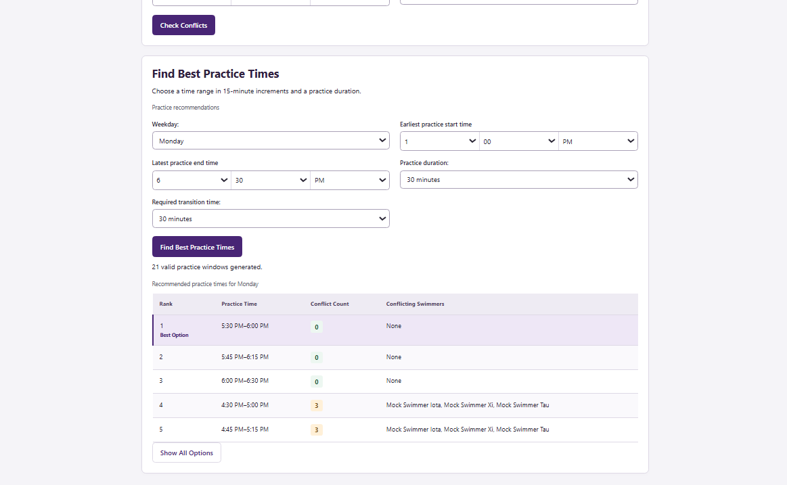
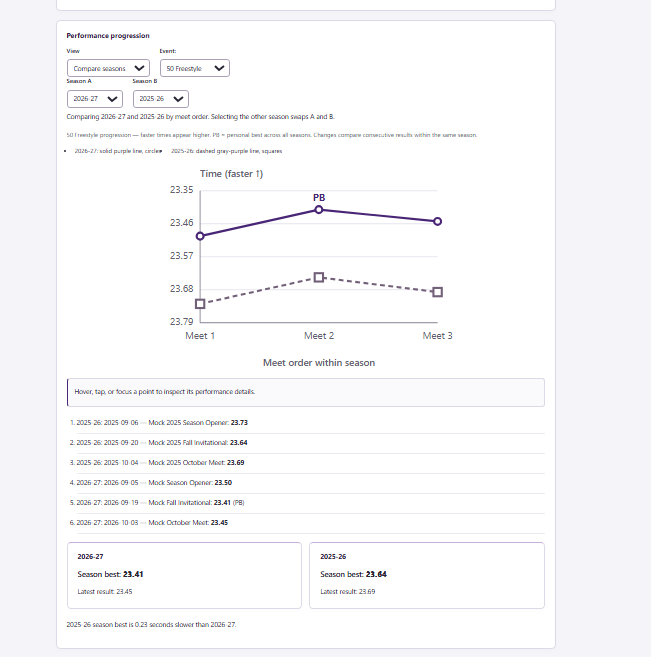

# UE Swimming & Diving Scheduling and Performance Platform

A two-semester senior Computer Science project for the University of Evansville Swimming & Diving team. The November 2026 local prototype combines practice scheduling and fictional multi-season swimming analytics in Coach and Swimmer experiences. A tested SQLite foundation prepares for future runtime persistence; the running application still uses frontend mock datasets.

## Prototype Screenshots

### Dynamic Practice-Time Recommendations



The Coach defines scheduling constraints and receives ranked practice-window recommendations.

### Multi-Season Performance Analytics



Coaches can compare a swimmer's performance across fictional seasons using a shared time scale.

## Project Goal / Problem

Class schedules, team schedules, and meet results are spread across multiple systems. Without one protected athletics practice period, coaches manually compare swimmers' class schedules to find practice times. This project brings scheduling and performance information together to help coaches identify lower-conflict practice windows and explore swimmer progression.

## Current Prototype Features

- React/Vite frontend connected to Python/FastAPI through the development proxy.
- Coach/Swimmer prototype roles and fictional swimmer identity selection.
- Twenty fictional swimmers with Monday-Friday classes; scheduling supports Monday-Sunday.
- Single-practice conflict checking and dynamic practice-time recommendations.
- Required transition times of 0, 5, 10, 15, or 30 minutes before and after practice. An exactly sufficient gap is allowed.
- Weekly calendars, individual roster schedule viewing, and responsive purple-and-neutral styling.
- Fictional 2025-26 and 2026-27 performance seasons with varied individual SCY specialties, career personal bests, latest times, and improvement information.
- Interactive SVG progression graphs, season comparison, and independently filtered Results History.
- SQLite schema, initialization, fictional seeding, read helpers, and database tests, isolated from the running application.

## Coach Prototype

Coach navigation contains Dashboard, Scheduling, Calendar, Performance, and Roster.

Scheduling retains **Check a Practice Time** and **Find Best Practice Times**. For recommendations, the Coach chooses weekday, earliest start, latest end, duration, and transition time. Supported durations are 30, 45, 60, 75, 90, 105, and 120 minutes. Python generates candidate starts every 15 minutes within the bounds and ranks candidates by conflicting-swimmer count, preserving chronological order for ties. All 20 fictional swimmers are included.

The interface initially displays the five best recommendations, labels the first **Best Option**, reports the total valid-window count, lists conflicts and swimmer names, and offers **Show All Options** / **Show Top 5**. User-facing scheduling times use AM/PM; API values remain 24-hour HH:MM.

Calendar shows mock team events with an optional swimmer class overlay. Roster shows one selected swimmer's schedule. Performance allows browsing all fictional swimmers and their tracked events:

- Single-season progression defaults to the most recent season, with an All seasons option.
- Mouse, keyboard, and touch point interactions expose meet/date, time, career PB status, previous-result change, and distance from PB where applicable.
- Compare seasons aligns Meet 1, Meet 2, and Meet 3 on one time scale, using distinct lines/markers and a legend. Summaries show each season's best/latest result and the season-best difference. Changes are calculated within each season.
- Results History filters independently by event, season, and newest/oldest order. Its selected-results summary includes count and latest result. Best and Improvement require a specific event; All events displays "Select an event" for both.

Career cards remain all-history. Lower swimming times are better; long events retain minutes:seconds.hundredths formatting. Textual graph fallbacks remain available.

## Swimmer Prototype

Select one fictional swimmer on the landing screen, then enter Dashboard, Calendar, or Performance. These views show that swimmer's summaries, classes alongside team events, and performance analytics, including season comparison and history filtering. No swimmer selector appears inside Swimmer mode; changing identity requires Switch Role. This restriction is a UI demonstration, not authentication or authorization.

## Technology

- Frontend: React, Vite, JavaScript, plain CSS, SVG charts, and React state navigation; no routing or charting library.
- Backend: Python, FastAPI, Uvicorn, venv, and pip.
- Database foundation: SQLite through Python's built-in sqlite3, with no ORM.
- Runtime data: local fictional JavaScript datasets; SQLite is not yet the application's runtime data source.
- Validation: Python unittest, frontend production build, and a Node performance-data validation script.
- Development connection: Vite proxies /api from port 5173 to FastAPI on port 8000.

Current endpoints:

- GET /api/health
- POST /api/conflicts
- POST /api/rank-practice-windows (retained API for supplied candidates)
- POST /api/recommend-practice-windows (dynamic recommendations used by Coach Scheduling)

Automatic API documentation routes are disabled.

## Repository Structure

```text
ue-swim-platform/
|-- frontend/
|   |-- src/components/     # Roles, calendar, performance graphs/history, controls
|   |-- src/data/           # Fictional schedules, team events, performance
|   |-- src/utils/          # Shared performance helpers
|   |-- src/App.jsx
|   |-- src/style.css
|   |-- scripts/validate-performance.mjs
|   |-- package.json
|   `-- vite.config.js
|-- backend/
|   |-- main.py
|   |-- conflict_detection.py
|   |-- practice_ranking.py
|   |-- database.py
|   |-- schema.sql
|   |-- seed_database.py
|   |-- seed_data.json
|   |-- export_seed.mjs
|   |-- DATABASE.md
|   |-- data/               # Generated, ignored local SQLite database
|   |-- test_*.py
|   `-- requirements.txt
|-- docs/
|   |-- architecture/
|   |-- requirements/
|   |-- proposal/
|   |-- preliminary design/
|   |-- responsible_computing/
|   |-- methods/
|   |-- testing/
|   |-- progress/
|   `-- screenshots/
|-- PROJECT_CONTEXT.md
`-- README.md
```

## Running the Project Locally

Use Windows PowerShell terminals in VS Code. Prerequisites: an existing Python 3.10+ installation and Node.js 22.12+ with npm, as documented in the component setup instructions.

### Backend: first-time setup

From the repository root:

```powershell
cd backend
python -m venv .venv
.\.venv\Scripts\python.exe -m pip install -r requirements.txt
.\.venv\Scripts\python.exe -m uvicorn main:app --reload --host 127.0.0.1 --port 8000
```

If Python is available through the Windows launcher, use `py -m venv .venv` instead of `python -m venv .venv`. If the project environment is already set up, skip environment creation and dependency installation. Directly invoking its Python avoids activation or execution-policy changes.

For subsequent starts, from the repository root:

```powershell
cd backend
.\.venv\Scripts\python.exe -m uvicorn main:app --reload --host 127.0.0.1 --port 8000
```

### Frontend: separate terminal

From the repository root:

```powershell
cd frontend
npm ci
npm run dev
```

After dependencies are installed, subsequent starts require only `npm run dev` from `frontend`. Open http://127.0.0.1:5173 and choose a prototype role. Keep both terminals running; stop each server with Ctrl+C. Vite requires port 5173 to be available.

Verify backend connectivity from another terminal:

```powershell
Invoke-RestMethod http://127.0.0.1:8000/api/health
```

It returns a status of `ok`. The Coach view also displays backend connection status. To check the frontend production build, run `npm run build` from `frontend`. This generates ignored `dist/` files; it does not deploy the application. The `/api` proxy is a development configuration.

### Optional database foundation setup

The UI does not require database initialization. To initialize, seed, and inspect the separate local database, run from the repository root:

```powershell
.\backend\.venv\Scripts\python.exe -B backend/database.py
.\backend\.venv\Scripts\python.exe -B backend/seed_database.py
.\backend\.venv\Scripts\python.exe -B backend/database.py --inspect
```

The generated backend/data/prototype.sqlite3 file is ignored by Git. The schema covers swimmers, seasons, class entries, meets, events, results, and team events. Multiple results may share a swimmer/event/meet; each result has its own unique ID. Swimmer status supports active/historical in the schema only; runtime behavior does not use it yet. See [database documentation](backend/DATABASE.md) for seed sources, repeat-run behavior, read helpers, and limitations.

## Running Backend Tests

From the repository root, after backend dependencies are installed:

```powershell
.\backend\.venv\Scripts\python.exe -B -m unittest discover -s backend -p "test_*.py" -v
```

Tests cover conflicts, transitions, weekdays, ranking, dynamic recommendations, API behavior, and the database foundation. Database tests use temporary files. No running server is required.

From frontend, run npm run build for production-build verification. From the repository root, validate fictional performance data and history summaries with:

```powershell
node frontend/scripts/validate-performance.mjs
```

There is no separate frontend lint command or automated browser-interaction suite.

## Responsible Computing / Prototype Data

All swimmer identities, class schedules, team events, meets, and performance values are fictional. No real private student-athlete information is used. Protecting athlete schedules, performance data, and eventual role permissions remains a design priority.

The role selector is not authentication. Mock datasets are bundled with the frontend; no private-data protection or production security is claimed. No external integration is required to run the prototype.

## Current Status

Working local prototype, **November 2026**. Steps 8, 9, and 10A are complete: dynamic scheduling recommendations; Coach/Swimmer views, calendars, roster browsing; multi-season fictional histories, interactive progression, season comparison, history filtering; and a seeded/tested relational SQLite foundation.

The running application still uses frontend mock datasets and submitted schedules. Full database-backed runtime persistence is not implemented. Neither are real authentication/authorization, real private athlete data, SwimCloud integration, meet-result uploads/imports, goal tracking, practice logging, or production deployment/application packaging.

Scheduling examines submitted class schedules; calendar team events are not automatically included. Overnight intervals and cross-day transitions are unsupported. The calendar is an undated fictional week. Season comparisons align meet order, not equivalent meet conditions. The schema supports multiple swims per event/meet but does not implement round/heat workflows.

## Future Work

The intentional next-step order is:

1. Step 10C - Active vs. historical swimmer behavior.
2. Step 10D - Coach roster management.
3. Step 10B - Meet-results import workflow.
4. Step 11 - Athlete/team goals and optional practice logging/progression.
5. Step 12 - Authentication, deployment, and application packaging.
6. Step 13 - Client feedback and usability testing.

Database-backed runtime data will be introduced incrementally. Future roster behavior should preserve historical performances: active swimmers would participate in current scheduling, while historical swimmers remain available for appropriate history/performance viewing. This runtime distinction is not implemented yet.

A future Coach import workflow could upload an appropriate meet-results file, extract supported swimmer/event/result/meet metadata, preview it, resolve unmatched records or duplicates, and confirm saving. Approved real-data imports or external integrations may be explored; SwimCloud must not be a runtime requirement. Additional testing and continued UI refinement remain ongoing priorities.

## Documentation

- [Project context and development guardrails](PROJECT_CONTEXT.md)
- [Frontend setup notes](frontend/README.md)
- [Backend setup notes](backend/README.md)
- [System architecture image](docs/architecture/Senior%20Project%20System%20Architecture.png)
- [Requirements document](docs/requirements/Requirments%20Document%20-%20Michael%20Pruett-%20CS%20-%20495.pdf)
- [Revised project proposal](docs/proposal/Michael%20Pruett-%20CS-495%20-%20Revised%20Proposal.pdf)
- [Preliminary design](docs/preliminary%20design/CS-495-Preliminary%20Design-Michael-Pruett.pdf)
- [Progress pitch 1](docs/progress/Michael-Pruett-Senior-Project-Progress-Pitch-%231.pptx)
- [Existing Coach dashboard image](docs/screenshots/Coach_Dashboard.png)

- [Database foundation and commands](backend/DATABASE.md)
- [Ethics / Responsible Computing](docs/responsible_computing/CS-495-Ethics%20and%20Responsible%20Computing-Michael%20Pruett.pdf)
- [Methods draft](docs/methods/Methods%20Draft%20-%20Michael%20Pruett-%20CS-495.pdf)
- [Testing plan](docs/testing/Testing%20Plan%20-%20CS-%20495%20-%20Michael%20Pruett.pdf)
- [Working Prototype v1 report](docs/progress/Working%20Prototype%20v1%20-%20CS-495-Michael%20Pruett.pdf)
- [Progress pitch 2](docs/progress/Michael-Pruett-Senior-Project-Progress-Pitch-2.pptx)
- [October 21 progress presentation](docs/progress/Progress%20Presentation-10-21-2026-Michael%20Pruett.pptx)

No standalone Problem Statement document was found in docs; the project problem is described above. Component READMEs retain early-prototype feature descriptions, but their startup instructions remain useful. Use this root README for current implementation status. Planning documents and historical reports may describe future scope or earlier milestones.
