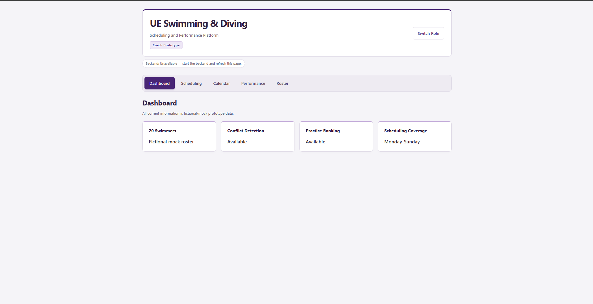

# UE Swimming & Diving Scheduling and Performance Platform

A two-semester senior Computer Science project for the University of Evansville Swimming & Diving team. The working local prototype brings scheduling tools and fictional swimming performance histories into separate Coach and Swimmer experiences.


## Prototype Screenshot



## Project Goal / Problem

Class schedules, team schedules, meet results, and other information are spread across multiple systems. Without one protected athletics practice period, coaches must manually compare swimmers' class schedules to find practice times. This project aims to bring scheduling and performance information together and help coaches identify lower-conflict practice windows.

## Current Prototype Features

- Connected React/Vite frontend and Python/FastAPI backend.
- Prototype Coach/Swimmer role selection and fictional swimmer identity selection.
- Exactly 20 fictional swimmers with Monday-Friday class schedules.
- Monday-Sunday conflict checking and ranking of predefined candidate practice windows.
- Required transition options of 0, 5, 10, 15, and 30 minutes, applied before and after practice. An exactly sufficient gap is allowed; zero preserves overlap-only checks.
- Reusable AM/PM practice-time controls; scheduling API values remain 24-hour `HH:MM` strings.
- Weekly calendar with mock practices, a meet, travel, and optional class overlays.
- Varied fictional individual SCY swimming specialties, personal bests, recent times, improvement, history, and simple progression lists.
- Responsive purple-and-neutral styling, readable forms, cards, tables, and status messages.

## Coach Prototype

Coach navigation contains Dashboard, Scheduling, Calendar, Performance, and Roster. The dashboard summarizes available tools. Scheduling checks one practice time or ranks six predefined windows using all 20 swimmers' class schedules. Ranking orders by conflicting-swimmer count and preserves input order for ties.

The weekly Calendar shows fictional team events and can overlay one selected swimmer's classes. Roster displays one selected swimmer's schedule. Performance allows browsing every fictional swimmer's tracked events and results.

## Swimmer Prototype

Select a fictional swimmer on the landing screen, then enter Dashboard, Calendar, or Performance. These views use that swimmer's ID to show personal summaries, their classes alongside team events, and their performance history. Changing identity requires returning with Switch Role. This is UI-only prototype selection, not login or access control.

## Technology

- Frontend: React, Vite, JavaScript, plain CSS, and React state navigation.
- Backend: Python, FastAPI, Uvicorn, `venv`, and `pip`.
- Tests: Python's built-in `unittest`.
- Data: local fictional JavaScript datasets; no database or persistence layer yet.
- Development connection: Vite proxies `/api` from port 5173 to FastAPI on port 8000.

Current endpoints are `GET /api/health`, `POST /api/conflicts`, and `POST /api/rank-practice-windows`. Automatic API documentation routes are disabled.

## Repository Structure

```text
ue-swim-platform/
|-- frontend/
|   |-- src/
|   |   |-- components/     # Calendar, performance, swimmer view, time selector
|   |   |-- data/           # Fictional schedules, team events, performance
|   |   |-- utils/          # Shared performance helpers
|   |   |-- App.jsx
|   |   `-- style.css
|   |-- package.json
|   `-- vite.config.js
|-- backend/
|   |-- main.py
|   |-- conflict_detection.py
|   |-- practice_ranking.py
|   |-- test_*.py
|   `-- requirements.txt
|-- docs/
|   |-- architecture/
|   |-- requirements/
|   |-- proposal/
|   |-- preliminary design/
|   |-- progress/
|   `-- screenshots/
|-- PROJECT_CONTEXT.md
`-- README.md
```

## Running the Project Locally

Use Windows PowerShell terminals in VS Code. Prerequisites: an existing Python 3.10+ installation and Node.js 22.12+ with npm, as documented in the component setup instructions.

### Backend: first-time setup

From the repository root:

```powershell
cd backend
python -m venv .venv
.\.venv\Scripts\python.exe -m pip install -r requirements.txt
.\.venv\Scripts\python.exe -m uvicorn main:app --reload --host 127.0.0.1 --port 8000
```

If Python is available through the Windows launcher, use `py -m venv .venv` instead of `python -m venv .venv`. If the project environment is already set up, skip environment creation and dependency installation. Directly invoking its Python avoids activation or execution-policy changes.

For subsequent starts, from the repository root:

```powershell
cd backend
.\.venv\Scripts\python.exe -m uvicorn main:app --reload --host 127.0.0.1 --port 8000
```

### Frontend: separate terminal

From the repository root:

```powershell
cd frontend
npm ci
npm run dev
```

After dependencies are installed, subsequent starts require only `npm run dev` from `frontend`. Open http://127.0.0.1:5173 and choose a prototype role. Keep both terminals running; stop each server with Ctrl+C. Vite requires port 5173 to be available.

Verify backend connectivity from another terminal:

```powershell
Invoke-RestMethod http://127.0.0.1:8000/api/health
```

It returns a status of `ok`. The Coach view also displays backend connection status. To check the frontend production build, run `npm run build` from `frontend`. This generates ignored `dist/` files; it does not deploy the application. The `/api` proxy is a development configuration.

## Running Backend Tests

From the repository root, after backend dependencies are installed:

```powershell
.\backend\.venv\Scripts\python.exe -B -m unittest discover -s backend -p "test_*.py" -v
```

Tests cover conflict detection, transitions, weekday support, practice ranking, and in-process API handling. No running server is required. Frontend scripts currently provide build checking, but no separate automated frontend test or lint command.

## Responsible Computing / Prototype Data

All swimmer identities, class schedules, team events, meets, and performance values are fictional. No real student-athlete information is used. Protecting athlete schedules, performance information, and eventual Coach/Swimmer permissions remains a design priority.

The role selector is not authentication. All mock datasets are bundled with the frontend. No private-data protection or production security is claimed, and no external integration is required to run the prototype.

## Current Status

Working local Prototype v1, October 2026. Scheduling, role-based prototype views, calendar display, performance histories, roster browsing, visual polish, and custom time controls are implemented.

Scheduling calculations currently examine submitted class schedules on the selected weekday; displayed calendar team events are not automatically included in those calculations. Overnight intervals and cross-day transitions are not supported. Candidate windows are predefined, not automatically generated. The calendar is a fictional weekday board rather than a dated live calendar. Performance summaries are calculated locally from mock results. There is no database, real authentication, external-data connection, or production deployment setup.

## Future Work

- Relational database and persistence.
- Authentication and real role permissions.
- Athlete and team goal tracking.
- Optional practice tracking.
- Approved real-data or external-data imports, if feasible.
- Additional automated and usability testing.
- Deployment.
- Continued UI refinement.

These are future directions, not currently implemented features.

## Documentation

- [Project context and development guardrails](PROJECT_CONTEXT.md)
- [Frontend setup notes](frontend/README.md)
- [Backend setup notes](backend/README.md)
- [System architecture image](docs/architecture/Senior%20Project%20System%20Architecture.png)
- [Requirements document](docs/requirements/Requirments%20Document%20-%20Michael%20Pruett-%20CS%20-%20495.pdf)
- [Revised project proposal](docs/proposal/Michael%20Pruett-%20CS-495%20-%20Revised%20Proposal.pdf)
- [Preliminary design](docs/preliminary%20design/CS-495-Preliminary%20Design-Michael-Pruett.pdf)
- [Progress pitch 1](docs/progress/Michael-Pruett-Senior-Project-Progress-Pitch-%231.pptx)
- [Existing Coach dashboard image](docs/screenshots/Coach_Dashboard.png)

The component READMEs retain early-prototype feature descriptions (including an outdated health-only backend description); their startup commands remain useful. Use this root README for the current feature inventory. Proposal, requirements, and architecture artifacts describe project planning and may include future scope.
